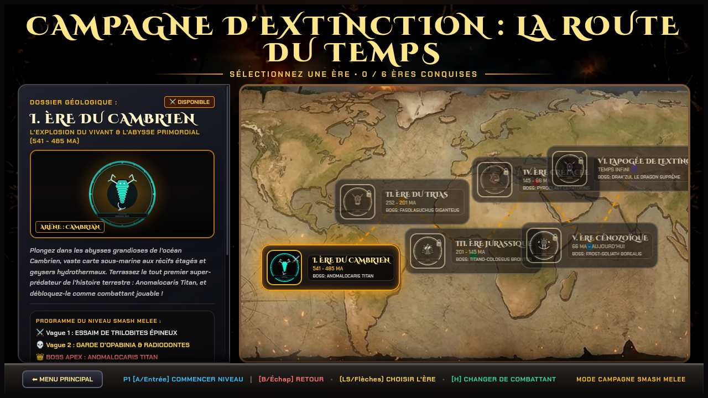
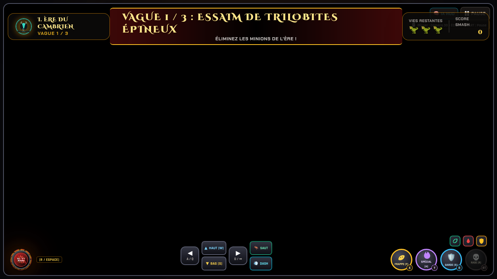
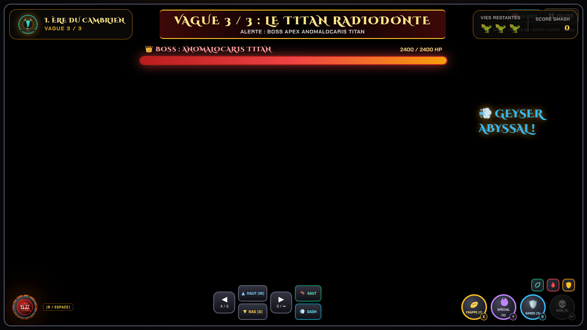
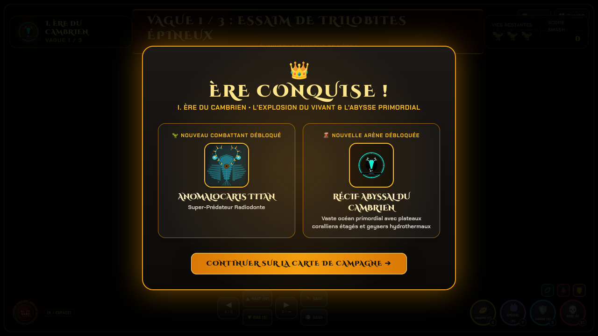
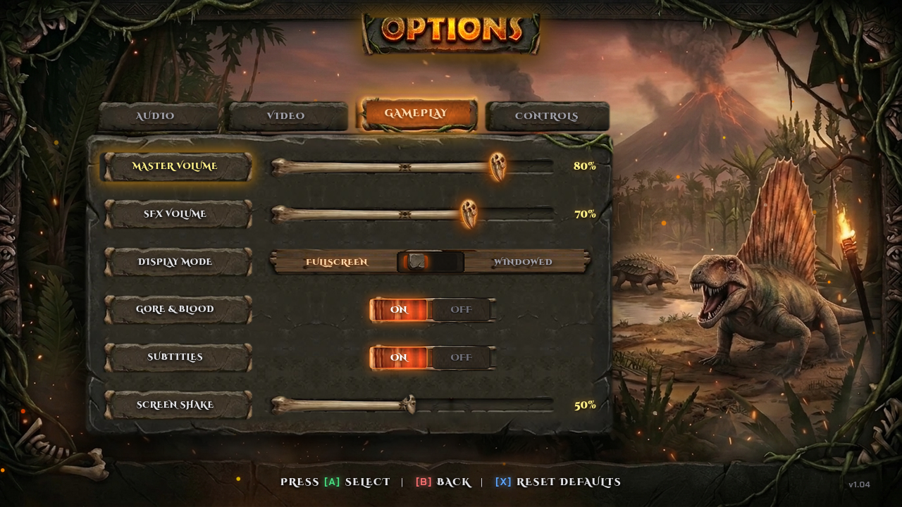
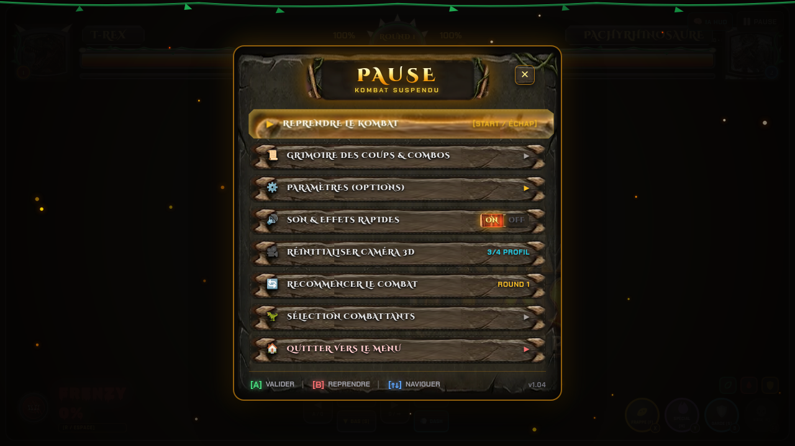
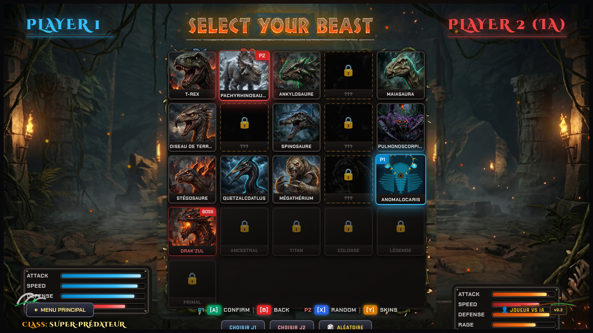
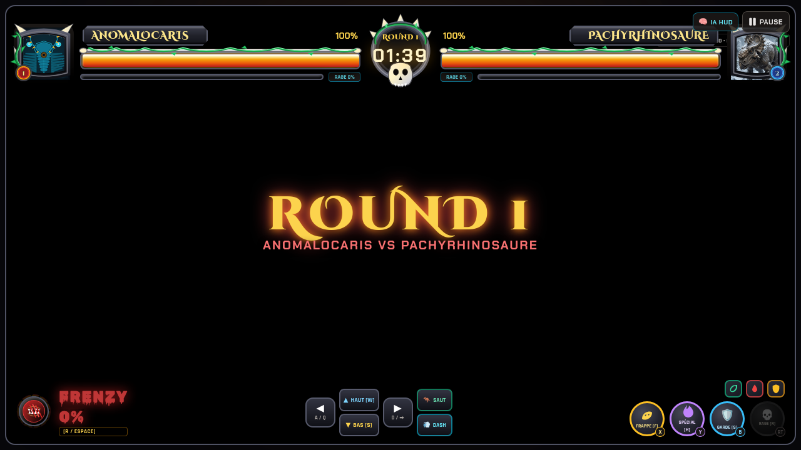

# 🦖 EXTINCTION KOMBAT 3D — *Jurassic Blood*

> **Jeu de combat 3D d'arcade préhistorique propulsé par Three.js et WebGL.**  
> Affrontez les prédateurs les plus redoutables de l'histoire de la Terre dans 8 arènes 3D dynamiques avec cinématiques X-Ray, fatalités viscérales et un mode Campagne immersif à travers les ères géologiques.

---

## 📸 Aperçu du Menu de Sélection des Combattants


---

## 🌟 Points Forts du Jeu

* **🦖 16 Combattants Préhistoriques (7 de base + 9 Déblocables)** :
  * **7 colosses disponibles dès le départ** (*T-Rex*, *Pachyrhinosaure*, *Ankylosaure*, *Maiasaura*, *Spinosaure*, *Stégosaure*, *Quetzalcoatlus*).
  * **9 Combattants Déblocables en Campagne** à travers les ères géologiques : **Anomalocaris** (Ère 1), **Pulmonoscorpius** (Ère 5), **Postosuchus** (Ère 7), **Apatosaure** (Ère 8), **Thérizinosaure** (Ère 9), **Oiseau de Terreur** (Ère 10), **Mégathérium** (Ère 11), **Smilodon** (Ère 12) et le dragon titanesque **Drak'Zul** (Ère 13, jouable une fois terrassé).
  * Rigs 3D articulés haute fidélité (modèle biomécanique pour le T-Rex, envergure aérienne pour le Quetzalcoatlus, appendices raptoriaux articulés pour l'Anomalocaris).
* **🗺️ Nouveau Mode Campagne — *L'Odyssée des Ères*** :
  * **Carte du Monde Pangaea Interactive** : Une frise géologique complète reliant **13 Ères** (du Cambrien à l'Apogée de l'Extinction), chacune dotée de son propre blason et de dangers environnementaux dédiés.
  * **Niveaux d'Ère par Vagues (Style Beat'em up / Melee)** : Chaque ère est un niveau complet avec essaims d'ennemis de l'époque (Trilobites, Archosaures, Raptors de cendre, Loups du blizzard), plateformes aériennes 3D et geysers hydrothermaux servant de tremplins verticaux de projection.
  * **Boss Titans Colossaux** : À l'apogée de chaque ère, affrontez un titan colossal sur mesure doté d'une gigantesque barre de vie, d'attaques de zone dévastatrices (jets d'acide, foudre sismique, météores, stalagmites) et d'un mode *Enrage* déclenché sous la barre des 40% de PV !
  * **Système de Récompenses & Déblocages Permanents** : Chaque victoire d'ère débloque de nouveaux combattants et de nouvelles arènes thématiques (sauvegarde persistante en `localStorage`).
* **🌋 8 Arènes 3D Interactives** :
  * Décors immersifs Three.js avec météo dynamique, météores incandescents, foudre sismique, éruptions volcaniques, blizzards polaires et faune cambrienne sous-marine.
* **💀 Mécaniques Avancées de Kombat** :
  * Système de combos fluides (Léger ➔ Lourd ➔ Spécial), cancels de dash et recovery frames.
  * Jauge de Rage à accumulation progressive avec cinématique de scanner médical **X-Ray** brisant le squelette anatomique de l'adversaire (à 100% de rage).
  * Séquence *"Achevez-le !"* : exécution de Fatalités 3D viscérales et sanglantes propres à chaque combattant.
* **⚙️ Refonte Complète des Interfaces (UI Overhaul 2.0)** :
  * **Nouveau Menu des Paramètres (Settings)** : Stèle monolithique en pierre sculptée sur fond préhistorique thématique avec 4 onglets dédiés (*Vidéo*, *Audio*, *Gameplay*, *Contrôles*), curseurs en os sculpté avec crânes de raptors lumineux, sélecteur Plein Écran / Fenêtré, ajustement précis du mixage sonore (Master, SFX, Musique) et interrupteurs bascule pour le Gore/Sang, les secousses d'écran et les vibrations.
  * **Nouveau Menu Pause Cinématographique** : Plaque de titre sculptée en pierre néolithique, fond assombri avec particules de braises incandescentes flottantes, commandes rapides en match et prise en charge intégrale du clavier (<kbd>Échap</kbd> / <kbd>P</kbd>) et des manettes.
* **🎮 Modes de Jeu Polyvalents** :
  * **1 Joueur** : Campagne d'Extinction (L'Odyssée des Ères), Joueur vs IA (Novice, Normal, Brutal), et Mode Entraînement.
  * **2 Joueurs** : 1 vs 1 Local sur le même clavier ou à la manette USB/Bluetooth.

---

## 📸 Galerie d'Écrans

| Carte de Campagne (Road Through Time) | Niveau d'Ère : Vague 1 Minions |
| :---: | :---: |
|  |  |

| Niveau d'Ère : Vague 3 Boss Colossal | Récompenses & Déblocages d'Ère |
| :---: | :---: |
|  |  |

| Nouveau Menu des Paramètres (Settings Overhaul) | Nouveau Menu Pause & Options Rapides |
| :---: | :---: |
|  |  |

| Anomalocaris (Écran de Sélection) | Anomalocaris (Combat 3D) |
| :---: | :---: |
|  |  |

---

## 🕹️ Commandes & Contrôles

Le jeu supporte le **clavier**, les **boutons tactiles arcade à l'écran**, et les **manettes de jeu (Gamepads)** USB / Bluetooth.

### Joueur 1 (Clavier)

| Action | Touche(s) Clavier |
| :--- | :--- |
| **Déplacement Gauche / Droite** | <kbd>Q</kbd> / <kbd>D</kbd> ou <kbd>A</kbd> / <kbd>D</kbd> (et <kbd>⬅</kbd> / <kbd>➡</kbd> en mode 1P) |
| **Visée Haute / Basse (Modificateur)** | Maintenir <kbd>Z</kbd> / <kbd>W</kbd> (Haut) ou <kbd>S</kbd> (Bas), ou <kbd>⬆</kbd> / <kbd>⬇</kbd> en 1P |
| **Saut** | <kbd>Espace</kbd> |
| **Garde / Parade** | <kbd>Shift Gauche</kbd> ou <kbd>S</kbd> |
| **Dash Rapide (Gauche / Droite)** | <kbd>E</kbd> (dans la direction) ou Double-pression (<kbd>A</kbd><kbd>A</kbd> / <kbd>Q</kbd><kbd>Q</kbd> / <kbd>D</kbd><kbd>D</kbd>) |
| **Attaque Directionnelle (Normale / Haute / Basse)** | <kbd>F</kbd> ou <kbd>J</kbd> (+ Haut/Bas pour varier la frappe) |
| **Attaque Spéciale** | <kbd>H</kbd> ou <kbd>L</kbd> |
| **X-Ray / Fatalité** | <kbd>R</kbd> (X-Ray à 100% de Rage / Fatalité lors de *"Achevez-le !"*) |
| **Pause / Menu Options en Match** | <kbd>Échap</kbd> (Escape) |

### Joueur 2 (1 vs 1 Local)

| Action | Touche(s) Clavier |
| :--- | :--- |
| **Déplacement Gauche / Droite** | <kbd>⬅</kbd> / <kbd>➡</kbd> |
| **Saut** | Pavé numérique <kbd>8</kbd> |
| **Garde** | Pavé numérique <kbd>5</kbd> ou <kbd>K</kbd> |
| **Dash Rapide** | Pavé numérique <kbd>6</kbd> ou Double-pression <kbd>⬅</kbd><kbd>⬅</kbd> / <kbd>➡</kbd><kbd>➡</kbd> |
| **Attaque** | Pavé numérique <kbd>1</kbd> ou <kbd>I</kbd> |
| **Attaque Spéciale** | Pavé numérique <kbd>2</kbd> ou <kbd>O</kbd> |
| **X-Ray / Fatalité** | Pavé numérique <kbd>0</kbd> ou <kbd>M</kbd> |

### Navigation dans le Menu Pause

| Action | Clavier | Manette (Gamepad) |
| :--- | :--- | :--- |
| **Naviguer entre les options** | Flèches <kbd>⬆</kbd> / <kbd>⬇</kbd> | Stick Gauche / Croix directionnelle <kbd>⬆</kbd> / <kbd>⬇</kbd> |
| **Sélectionner / Valider** | <kbd>Entrée</kbd> ou <kbd>Espace</kbd> | Bouton <kbd>A</kbd> (Xbox) / <kbd>✕</kbd> (PlayStation) |
| **Reprendre le combat** | <kbd>Échap</kbd> ou <kbd>P</kbd> | Bouton <kbd>Start</kbd> ou <kbd>B</kbd> / <kbd>◯</kbd> |

---

## 🦖 Roster des Combattants (16 Créatures)

| # | Combattant | Déblocage | Rôle | Attaques Spéciales | Fatalité 3D |
| :-: | :--- | :---: | :--- | :--- | :--- |
| 1 | **T-Rex** | De base | Apex Carnivore | Morsure Sismique • Rugissement Magma | *Dévoration Royale* |
| 2 | **Pachyrhinosaure** | De base | Bélier Blindé | Charge Boréale • Cornes Sismiques | *Impact Crânien Polaire* |
| 3 | **Ankylosaure** | De base | Forteresse Vivante | Marteau d'Os • Bouclier d'Écailles | *Brise-Fossile* |
| 4 | **Apatosaure** | Ère 8 | Titan Sismique | Écrasement Colossal • Coup de Fouet Caudal | *Onde d'Extinction* |
| 5 | **Maiasaura** | De base | Protectrice Féroce | Ruade Maternelle • Balayage Protecteur | *Furie du Nid* |
| 6 | **Oiseau de Terreur** | Ère 10 | Faucheur Véloce | Piqué Mortel • Griffes Tranchantes | *Assaut Aviaire* |
| 7 | **Postosuchus** | Ère 7 | Archosaurien Carnassier | Morsure Basse • Charge Reptilienne | *Déchirement des Marais* |
| 8 | **Spinosaure** | De base | Léviathan du Crétacé | Lame Dorsale • Geyser Aquatique | *Tranchant Abyssal* |
| 9 | **Thérizinosaure** | Ère 9 | Faucheuse Préhistorique | Faucilles Acérées • Valse Sanglante | *Moisson Funeste* |
| 10 | **Pulmonoscorpius** | Ère 5 | Scorpion Primordial | Dard Empoisonné • Étreinte Venimeuse | *Piqûre Neurotoxique* |
| 11 | **Stégosaure** | De base | Sentinelle à Plaques | Thagomizer • Balayage d'Épines | *Empalement Dorsal* |
| 12 | **Quetzalcoatlus** | De base | Monarque Céleste | Piqué Supersonique • Rafale de Tempête | *Chute Céleste* |
| 13 | **Mégathérium** | Ère 11 | Colosse Paresseux | Coup de Griffe Brutal • Écrasement Tellurique | *Pilonnage Géant* |
| 14 | **Anomalocaris** | Ère 1 | Super-Prédateur Radiodonte | Vortex Hydro-Sismique • Broyeur Raptorial | *Broyage Abyssal de Peytoia* |
| 15 | **Smilodon** | Ère 12 | Tigre à Dents de Sabre | Bond Prédateur • Morsure Mortelle | *Égorgement Fatal* |
| 16 | **Drak'Zul** | Ère 13 | Boss Suprême / Dragon Titan | Souffle Infernal • Cataclysme Éruptif | *Incinération Suprême* |

---

## 🏟️ Arènes 3D Disponibles (8 Décors)

1. **🌋 Cratère du Chicxulub** *(De base)* : Lave en fusion, météores incandescents et sol sismique instable.
2. **🏛️ Citadelle Céleste d'Os** *(De base)* : Arches thoraciques gigantesques de titanosaures et aurores astrales mystiques.
3. **🌊 Récif Abyssal du Cambrien** *(Déblocable — Ère 1)* : Fonds marins primordiaux aux coraux bioluminescents, plateformes rocheuses surélevées et geysers hydrothermaux.
4. **🍄 Abysse Fongique Toxique** *(Déblocable — Ère 5)* : Champignons géants bioluminescents et vapeurs d'acide primordial.
5. **⚡ Canyon de l'Orage Primordial** *(Déblocable — Ère 7)* : Colonnes basaltiques monumentales, pluie torrentielle et tempêtes d'éclairs foudroyants.
6. **🌿 Vallée d'Émeraude** *(Déblocable — Ère 8)* : Jungle luxuriante dense avec fougères colossales, cascades et canopée jurassique.
7. **❄️ Glacier de l'Ère Glaciaire** *(Déblocable — Ère 12)* : Blizzard de flocons en 3D, pics de glace cristallins, ossements et aurore boréale polaire.
8. **🐲 L'Antre de Drak'Zul** *(Déblocable — Ère 13)* : Caldera volcanique apocalyptique sous un ciel incandescent, arène ultime de l'Extinction.

---

## 📁 Architecture Modulaire du Code

Le jeu est découpé de manière modulaire (animations par combattant, modules d'arène indépendants, gestionnaires de menus et moteur de combat) :

```text
ExtinctionFighter/
├── index.html                 # Point d'entrée HTML5
├── README.md                  # Documentation complète du jeu
├── css/
│   └── style.css              # Styles arcade, animations CSS & thèmes de pierre
├── assets/                    # Ressources graphiques & 3D
│   ├── mockups/               # Décors de fond HD (carte de campagne, settings)
│   ├── models/                # Modèles 3D GLTF / GLB (créatures cambriennes Blender)
│   ├── portraits/             # Portraits haute résolution de chaque créature
│   └── ui/                    # Éléments d'interface sculptés (plaques, dalles de pierre, stèles)
├── screenshots/               # Captures d'écran et galerie visuelle
└── js/
    ├── libs/                  # Bibliothèques 3D, UI & IA embarquées (zéro bundler)
    │   ├── three.min.js               # Moteur WebGL 3D Three.js
    │   ├── pmndrs-uikit.min.js        # Système UI 3D/Spatial & Flexbox réactif (@pmndrs/uikit + @preact/signals-core)
    │   ├── yuka.min.js                # Moteur IA Yuka (Steering, Vision, Memory, Flocking, SyncManager)
    │   ├── kompute-tactical.js        # Analyse spatiale tactique Kompute (Sweet-spot, esquive projectiles)
    │   ├── three-pathfinding.min.js   # Navigation Mesh 3D A* & simulateur de foule RVO
    │   ├── behaviortree.min.js        # Arbres de comportement BehaviorTree.js (Selector, Sequence, Action)
    │   └── xstate.umd.js              # Machines à états finis déterministes XState
    ├── core/                  # Moteur principal du jeu
    │   ├── registry.js        # Registre global des combattants, boss, arènes et déblocages
    │   ├── state.js           # Variables d'état, flags de progression et configuration
    │   ├── rig.js             # Moteur de génération des squelettes 3D articulés
    │   ├── animation.js       # Système cinématique et chargement des animations modulaires
    │   ├── scene.js           # Gestionnaire de scène 3D, caméra dynamique et rendu graphique
    │   ├── arena.js           # Constructeur d'arènes, décors 3D et extraction NavMesh
    │   ├── fighter.js         # Classe Fighter3D (physique, vélocité, PV, barres de rage)
    │   ├── combat.js          # Hitboxes, détection de collisions, guard break et combos
    │   ├── prototype-combat-system.js # Système de combat avancé et timing d'attaques
    │   ├── campaign-level.js  # Moteur du mode Campagne par vagues (minions, geysers, boss titans, drops)
    │   ├── effects.js         # Particules de sang, os, projectiles et scanner médical X-Ray
    │   ├── input.js           # Gestionnaire d'entrées clavier, boutons tactiles et manettes de jeu
    │   ├── sound.js           # Synthétiseur audio Web Audio API indépendant
    │   ├── match.js           # Gestion des rounds, arbitre, cinématiques d'introduction et de victoire
    │   ├── ai-navmesh.js      # Étape 1 IA : Génération NavMesh 3D & requêtes spatiales Kompute
    │   ├── ai-steering.js     # Étape 2 IA : Véhicules Yuka, Goal Evaluators & Flocking faune 3D
    │   ├── ai-statechart.js   # Étape 3a IA : Statecharts macro-stratégiques XState
    │   ├── ai-behaviortree.js # Étape 3b IA : Arbre tactique BehaviorTree.js (combos, mix-ups, punitions)
    │   └── ai.js              # Pipeline IA 4-Étapes & télémétrie en temps réel
    ├── animations/            # Modules d'animation indépendants par créature
    │   ├── common/            # Biophénomènes communs (attack_biomechanics, combat_reactions, rig_reset)
    │   ├── trex/              # Animations dédiées T-Rex (idle, walking, jumping, attacking, fatality)
    │   ├── quetzalcoatlus/    # Animations dédiées Quetzalcoatlus (vol, battements d'ailes, piqué)
    │   ├── smilodon/          # Animations dédiées Smilodon
    │   └── ...                # Dossier dédié pour chacun des 16 combattants
    ├── fighters/              # Implémentation modulaire et rigs anatomiques par créature
    │   ├── trex.js
    │   ├── pachyrhinosaurus.js
    │   ├── ankylosaurus.js
    │   ├── apatosaurus.js
    │   ├── maiasaura.js
    │   ├── terror-bird.js
    │   ├── postosuchus.js
    │   ├── spinosaurus.js
    │   ├── therizinosaurus.js
    │   ├── pulmonoscorpius.js
    │   ├── stegosaurus.js
    │   ├── quetzalcoatlus.js
    │   ├── megatherium.js
    │   ├── anomalocaris.js    # Super-prédateur cambrien déblocable
    │   ├── smilodon.js        # Tigre à dents de sabre déblocable
    │   └── dragon.js          # Boss Drak'Zul déblocable et jouable
    ├── arenas/                # Un fichier modulaire par arène 3D
    │   ├── cambrian.js        # Récif marin avec geysers hydrothermaux & plateformes
    │   ├── jungle.js          # Vallée d'Émeraude (jungle jurassique luxuriante)
    │   ├── volcano.js         # Cratère du Chicxulub
    │   ├── boneyard.js        # Citadelle Céleste d'Os
    │   ├── swamp.js           # Abysse Fongique Toxique
    │   ├── storm.js           # Canyon de l'Orage Primordial
    │   ├── ice-age.js         # Glacier de l'Ère Glaciaire
    │   └── dragon-lair.js     # L'Antre Infernale de Drak'Zul
    ├── menus/                 # Composants d'interface utilisateur (UI)
    │   ├── header.js          # Barre d'en-tête & Menu Pause complet en bas-relief sculpté
    │   ├── main-menu.js       # Écran d'accueil principal (1P Campagne / IA, 2P 1v1)
    │   ├── campaign-map.js    # Carte de Campagne interactive Pangaea à travers les 13 ères
    │   ├── select-screen.js   # Écran de sélection des combattants avec aperçus 3D tournants
    │   ├── arena-chooser.js   # Écran de choix d'arène avec vue 3D dynamique
    │   ├── settings-modal.js  # Stèle néolithique des réglages (Vidéo, Audio, Gameplay, Contrôles)
    │   ├── battle-screen.js   # HUD de match, jauges de vie sculptées et barres de Rage
    │   ├── post-match.js      # Écran de fin de match et attribution des récompenses
    │   └── moves-modal.js     # Grimoire interactif des coups spéciaux et fatalités
    ├── tools/                 # Scripts Python / Blender pour génération de modèles 3D & tests
    └── main.js                # Boucle principale (requestAnimationFrame) et cycle de vie
```

---

## 🚀 Comment Lancer le Jeu

1. **Directement dans le navigateur** :
   Ouvrez simplement le fichier `index.html` dans n'importe quel navigateur moderne (Firefox, Chrome, Edge, Safari).

2. **Via un serveur local HTTP** (recommandé pour le chargement des textures et modèles 3D GLTF) :
   ```bash
   # Avec Python 3
   python3 -m http.server 8080

   # Avec Node.js (npx)
   npx serve .
   ```
   Rendez-vous ensuite sur `http://localhost:8080`.

---

## 📜 Technologies Utilisées

* **Moteur 3D WebGL** : [Three.js](https://threejs.org/)
* **Modélisation & Pipeline 3D** : Blender + Python pour la modélisation squelettique et export GLTF / GLB (`assets/models/cambrian_creatures_blender.glb`)
* **Système UI & Composants Spatiaux** : [`@pmndrs/uikit`](https://pmndrs.github.io/uikit/) avec signaux réactifs `@preact/signals-core` et layout Flexbox Yoga-compatible
* **Pipeline d'Intelligence Artificielle en 4 Étapes** :
  * Étape 1 : **Three-Pathfinding** (`three-pathfinding`) et **Kompute Tactical** (analyse spatiale, sweet-spotting et esquive de projectiles)
  * Étape 2 : **Yuka** (`yuka`) (véhicules autonomes, goal evaluators et flocking)
  * Étape 3 : **XState** (`xstate`) (Statecharts macro-stratégiques déterministes) & **BehaviorTree.js** (arbres tactiques de combos et punitions)
  * Étape 4 : Télémétrie adaptative et exécution physique temps réel
* **Audio Dynamique** : Web Audio API (synthétiseur rétro-arcade natif sans fichiers externes lourds)
* **Code JavaScript Pur (ES6+)** : Architecture modulaire découplée sans bundler ni étape de compilation obligatoire.
