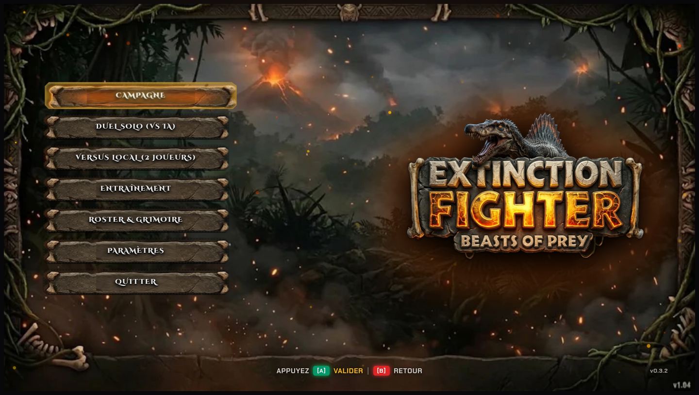
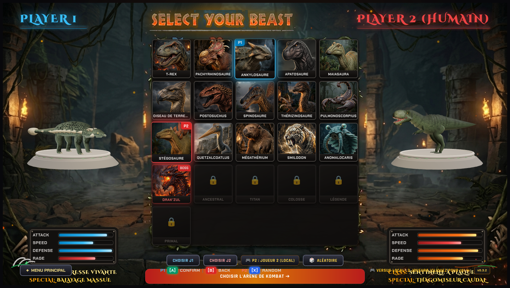
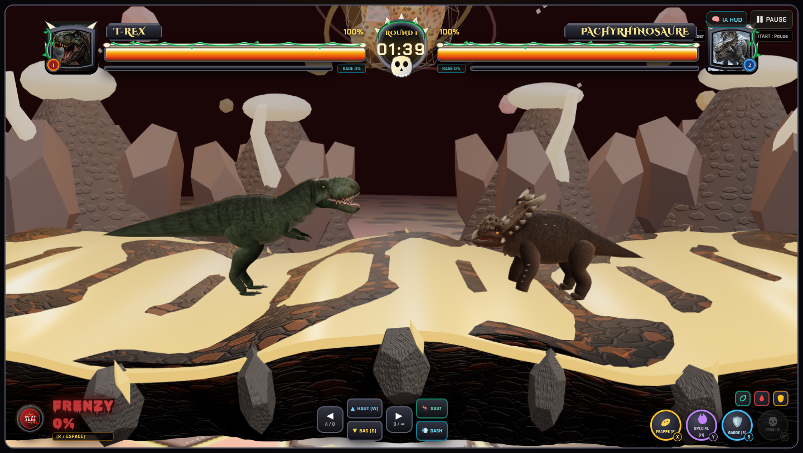
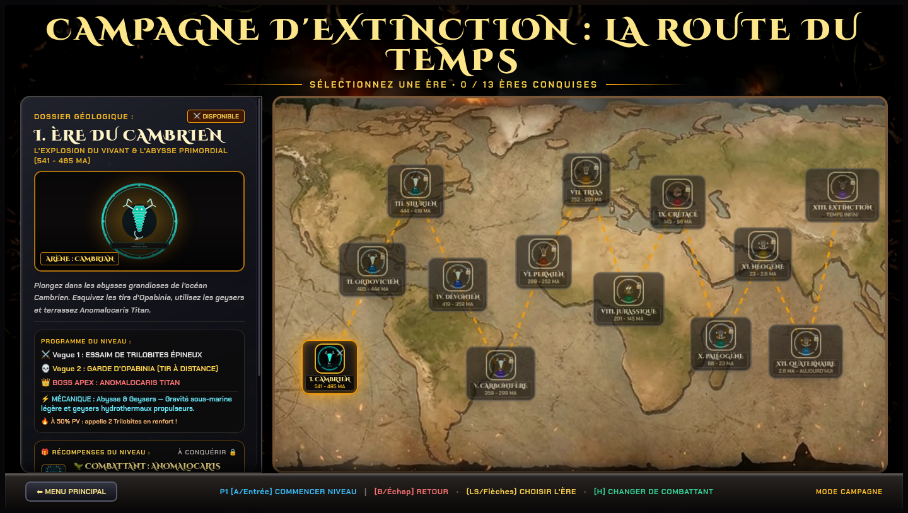

# 🦖 EXTINCTION KOMBAT 3D — *Jurassic Blood* (`v0.3.2`)

> Jeu de combat 3D d'arcade préhistorique propulsé par Three.js et WebGL.  
> Affrontez des prédateurs sculptés sous Blender avec textures PBR dans 8 arènes 3D, cinématiques X-Ray, fatalités et un mode Campagne sur 13 ères géologiques.

---

## 📸 Aperçu (`v0.3.2`)

| Menu Principal | Sélection des Combattants |
| :---: | :---: |
|  |  |

| Combat 3D (T-Rex vs Pachyrhinosaure) | Carte de Campagne (*L'Odyssée des Ères*) |
| :---: | :---: |
|  |  |

---

## 🌟 Essentiel du Jeu

- **16 Combattants Préhistoriques** : 3 disponibles dès le départ (*T-Rex*, *Stégosaure*, *Quetzalcoatlus*) et 13 à débloquer en Campagne (jusqu'à *Drak'Zul*).
- **Pipeline 3D Blender `.glb` & PBR** : 46 modèles `.glb` sculptés sous Blender (16 combattants, 19 sbires et 11 boss/objets de campagne) avec textures PBR.
- **Mode Campagne (13 Ères)** : Niveaux par vagues, dangers environnementaux, boss titans et déblocages persistants (`localStorage`).
- **8 Arènes 3D** : Décors Three.js avec météo dynamique et dangers interactifs.
- **Kombat Arcade** : Combos, dashs, jauge de Rage, cinématique **X-Ray** à 100% et **Fatalités 3D**.
- **Modes** : Campagne, 1P vs IA (4 niveaux de difficulté), Entraînement et 1v1 Local (clavier, tactile ou manette).

---

## 🚀 Lancer le Jeu

Un serveur HTTP local est requis pour charger les modèles `.glb` (CORS bloque `file://`).

```bash
# Linux / macOS (serveur sans cache recommandé)
./start.sh

# Windows
start.bat
```

Options utiles : `--unlock-all` pour débloquer immédiatement les 16 combattants.

Alternatives :

```bash
python3 -m http.server 8080
# ou
npx serve .
```

Puis ouvrez `http://localhost:8080`.

---

## 🕹️ Contrôles

| Action | Joueur 1 (Clavier) | Joueur 2 (1v1 Local) |
| :--- | :--- | :--- |
| **Déplacement** | <kbd>Q</kbd> / <kbd>D</kbd> ou <kbd>A</kbd> / <kbd>D</kbd> (ou <kbd>⬅</kbd> / <kbd>➡</kbd> en 1P) | <kbd>⬅</kbd> / <kbd>➡</kbd> |
| **Visée Haute / Basse** | <kbd>Z</kbd> / <kbd>W</kbd> (Haut) • <kbd>S</kbd> (Bas) | — |
| **Saut** | <kbd>Espace</kbd> | Pavé num. <kbd>8</kbd> |
| **Garde** | <kbd>Shift Gauche</kbd> ou <kbd>S</kbd> | Pavé num. <kbd>5</kbd> ou <kbd>K</kbd> |
| **Dash** | <kbd>E</kbd> ou double-pression | Pavé num. <kbd>6</kbd> ou double-pression |
| **Attaque** | <kbd>F</kbd> ou <kbd>J</kbd> | Pavé num. <kbd>1</kbd> ou <kbd>I</kbd> |
| **Spéciale** | <kbd>H</kbd> ou <kbd>L</kbd> | Pavé num. <kbd>2</kbd> ou <kbd>O</kbd> |
| **X-Ray / Fatalité** | <kbd>R</kbd> | Pavé num. <kbd>0</kbd> ou <kbd>M</kbd> |
| **Pause** | <kbd>Échap</kbd> ou <kbd>P</kbd> | — |

Manettes USB/Bluetooth et boutons tactiles pris en charge.

---

## 📋 Historique des Versions

Consultez [CHANGELOG.md](CHANGELOG.md) pour le détail complet des mises à jour.
