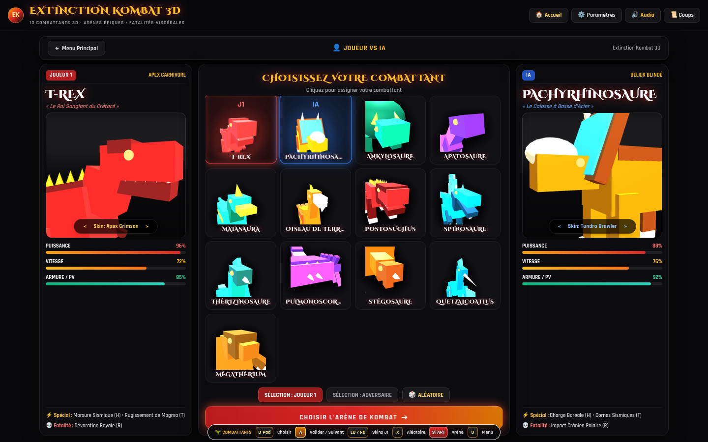
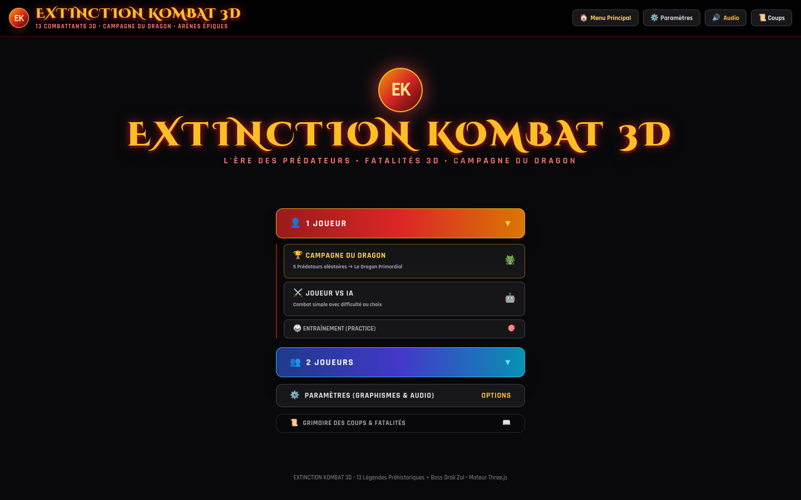
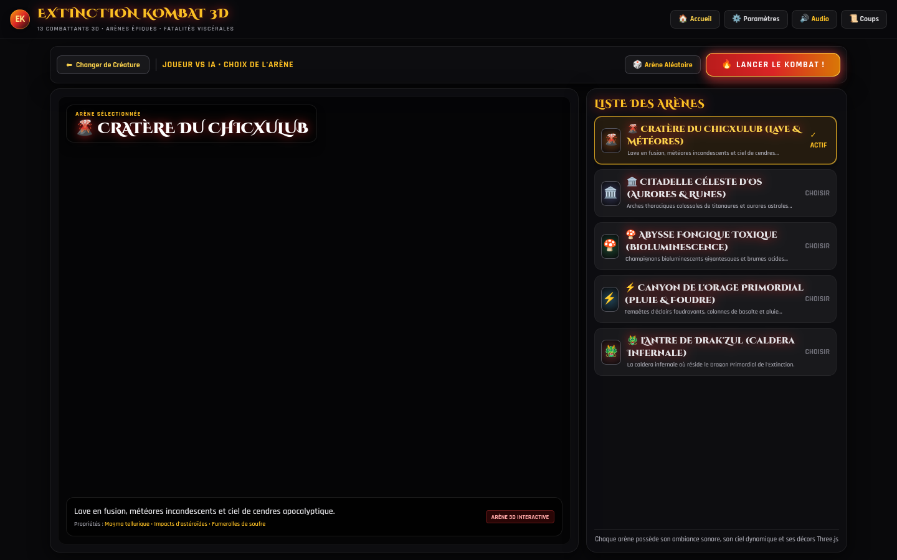

# 🦖 EXTINCTION KOMBAT 3D — *Jurassic Blood*

> **Jeu de combat 3D d'arcade préhistorique propulsé par Three.js et WebGL.**  
> Affrontez les prédateurs les plus redoutables de l'histoire de la Terre dans des arènes 3D dynamiques avec cinématiques X-Ray et fatalités viscérales.

---

## 📸 Aperçu du Menu de Sélection des Combattants



---

## 🌟 Points Forts du Jeu

* **13 Légendes Préhistoriques + 1 Combattant Déblocable + Boss Secret** : Chaque combattant possède son propre rig 3D articulé, sa palette de coups, ses skins alternatifs, ses attaques spéciales et sa propre Fatalité 3D.
* **🏆 Mode Campagne d'Extinction** : Gravissez 6 étapes épiques en battant 5 prédateurs aléatoires avant d'affronter l'ultime épreuve finale secrète contre Drak'Zul pour débloquer le redoutable **Smilodon (Tigre à Dents de Sabre)** !
* **🎮 Modes de Jeu Complets** :
  * **1 Joueur** : Campagne d'Extinction, Joueur vs IA (Novice, Normal, Brutal), et Mode Entraînement.
  * **2 Joueurs** : 1 vs 1 Local sur le même clavier ou à la manette.
* **🌋 Arènes 3D Interactives** : 5 décors Three.js avec météo dynamique, météores, éclairs, lave et aurores boréales.
* **💀 Mécaniques Avancées de Kombat** :
  * Système de combos fluides (Léger ➔ Lourd ➔ Spécial).
  * Dash rapide et cancels d'attaques.
  * Jauge de Rage avec cinématique de scanner médical **X-Ray** brisant le squelette de l'adversaire.
  * Séquence *"Achevez-le !"* et exécution de Fatalités 3D uniques.
* **⚙️ Réglages Graphiques & Immersion** :
  * 4 niveaux de détails graphiques (*Faible*, *Moyenne*, *Élevée*, *Ultra*).
  * Mode Plein Écran à 100% du viewport.
  * Audio synthétiseur rétro arcade intégré.

---

## 📸 Galerie d'Écrans

| Menu Principal | Sélecteur d'Arène 3D |
| :---: | :---: |
|  |  |

---

## 🕹️ Commandes & Contrôles

Le jeu supporte le **clavier**, les **boutons tactiles arcade à l'écran**, et les **manettes de jeu (Gamepads)** USB / Bluetooth.

### Joueur 1 (Clavier)

| Action | Touche(s) Clavier |
| :--- | :--- |
| **Déplacement Gauche / Droite** | <kbd>Q</kbd> / <kbd>D</kbd> ou <kbd>A</kbd> / <kbd>D</kbd> |
| **Saut** | <kbd>Z</kbd> ou <kbd>W</kbd> |
| **Garde / Accroupi** | <kbd>S</kbd> (réduit les dégâts de 78%) |
| **Dash Rapide** | <kbd>E</kbd> ou Double-pression directionnelle |
| **Attaque Légère** | <kbd>F</kbd> ou <kbd>J</kbd> |
| **Attaque Lourde** | <kbd>G</kbd> ou <kbd>K</kbd> |
| **Attaque Spéciale 1** | <kbd>H</kbd> ou <kbd>L</kbd> |
| **Attaque Spéciale 2 (Ultra)** | <kbd>T</kbd> ou <kbd>U</kbd> |
| **X-Ray / Fatalité** | <kbd>R</kbd> ou <kbd>Espace</kbd> (Rage à 100% ou lors de *"Achevez-le !"*) |

### Joueur 2 (1 vs 1 Local)

| Action | Touche(s) Clavier |
| :--- | :--- |
| **Déplacement / Saut / Garde** | Flèches directionnelles <kbd>⬅</kbd> <kbd>⬆</kbd> <kbd>⬇</kbd> <kbd>➡</kbd> |
| **Dash Rapide** | Pavé numérique <kbd>0</kbd> |
| **Attaques (Léger / Lourd / Spéciaux)** | Pavé numérique <kbd>1</kbd>, <kbd>2</kbd>, <kbd>3</kbd>, <kbd>4</kbd> ou <kbd>I</kbd>, <kbd>O</kbd>, <kbd>P</kbd>, <kbd>[</kbd> |
| **X-Ray / Fatalité** | Pavé numérique <kbd>5</kbd> ou <kbd>Entrée</kbd> |

---

## 🦖 Roster des Combattants (13 Créatures + 1 Déblocable + 1 Boss)

| # | Combattant | Rôle | Attaques Spéciales | Fatalité 3D |
| :-: | :--- | :--- | :--- | :--- |
| 1 | **T-Rex** | Apex Carnivore | Morsure Sismique • Rugissement Magma | *Dévoration Royale* |
| 2 | **Pachyrhinosaure** | Bélier Blindé | Charge Boréale • Cornes Sismiques | *Impact Crânien Polaire* |
| 3 | **Ankylosaure** | Forteresse Vivante | Marteau d'Os • Bouclier d'Écailles | *Brise-Fossile* |
| 4 | **Apatosaure** | Titan Sismique | Écrasement Colossal • Coup de Fouet Caudal | *Onde d'Extinction* |
| 5 | **Maiasaura** | Protectrice Féroce | Ruade Maternelle • Balayage Protecteur | *Furie du Nid* |
| 6 | **Oiseau de Terreur** | Faucheur Véloce | Piqué Mortel • Griffes Tranchantes | *Assaut Aviaire* |
| 7 | **Postosuchus** | Archosaurien Carnassier | Morsure Basse • Charge Reptilienne | *Déchirement des Marais* |
| 8 | **Spinosaure** | Léviathan du Crétacé | Lame Dorsale • Geyser Aquatique | *Tranchant Abyssal* |
| 9 | **Thérizinosaure** | Faucheuse Préhistorique | Faucilles Acérées • Valse Sanglante | *Moisson Funeste* |
| 10 | **Pulmonoscorpius** | Scorpion Géant Primordial | Dard Empoisonné • Étreinte Venimeuse | *Piqûre Neurotoxique* |
| 11 | **Stégosaure** | Sentinelle à Plaques | Thagomizer • Balayage d'Épines | *Empalement Dorsal* |
| 12 | **Quetzalcoatlus** | Monarque Céleste | Piqué Supersonique • Rafale de Tempête | *Chute Céleste* |
| 13 | **Mégathérium** | Colosse Paresseux | Coup de Griffe Brutal • Écrasement Tellurique | *Pilonnage Géant* |
| 🐯 | **Smilodon (Déblocable)** | Tigre à Dents de Sabre | Bond Prédateur • Morsure Mortelle | *Égorgement Fatal* |
| 👑 | **??? (Boss Secret)** | L'Inconnu de l'Extinction | Dévoilé à l'Étape 6 de la Campagne | *Fatalité Secrète* |

---

## 🏟️ Arènes 3D Disponibles

1. **🌋 Cratère du Chicxulub** : Lave en fusion, météores incandescents et sol sismique instable.
2. **🏛️ Citadelle Céleste d'Os** : Arches thoraciques gigantesques de titanaures et aurores astrales mystiques.
3. **🍄 Abysse Fongique Toxique** : Champignons géants bioluminescents et brume d'acide suffocante.
4. **⚡ Canyon de l'Orage Primordial** : Colonnes de basalte, pluie torrentielle et tempêtes d'éclairs foudroyants.
5. **🐲 L'Antre Infernale** : Caldera volcanique secrète réservée à l'affrontement final de la Campagne.

---

## 📁 Architecture Modulaire du Code

Le jeu est découpé de manière modulaire (un fichier par combattant, par menu, par arène) :

```text
ExtinctionFighter/
├── index.html                 # Point d'entrée HTML5
├── README.md                  # Documentation du jeu
├── css/
│   └── style.css              # Styles et animations d'arcade
├── screenshots/               # Captures d'écran du jeu
│   ├── character-select.png
│   ├── main-menu.png
│   └── arena-select.png
└── js/
    ├── core/                  # Moteur principal du jeu
    │   ├── registry.js        # Registre global des combattants et boss
    │   ├── state.js           # Variables d'état et configuration
    │   ├── rig.js             # Moteur de génération des squelettes 3D Three.js
    │   ├── animation.js       # Système d'animation cinématique 3D
    │   ├── scene.js           # Gestionnaire de scène 3D, caméra et réglages graphiques
    │   ├── arena.js           # Constructeur des décors 3D
    │   ├── fighter.js         # Classe Fighter3D (physique, PV, barres de rage)
    │   ├── combat.js          # Hitboxes, collisions et système de combos
    │   ├── effects.js         # Particules de sang, os, projectiles et scanner X-Ray
    │   ├── input.js           # Gestionnaire clavier, boutons tactiles et manettes
    │   ├── sound.js           # Synthétiseur audio Web Audio API
    │   ├── match.js           # Gestion des rounds, arbitre et fin de match
    │   └── ai.js              # Intelligence artificielle adaptative
    ├── fighters/              # Un fichier modulaire par combattant
    │   ├── trex.js
    │   ├── pachyrhinosaurus.js
    │   ├── ankylosaurus.js
    │   ├── apatosaurus.js
    │   ├── maiasaura.js
    │   ├── terror-bird.js
    │   ├── postosuchus.js
    │   ├── spinosaurus.js
    │   ├── therizinosaurus.js
    │   ├── pulmonoscorpius.js
    │   ├── stegosaurus.js
    │   ├── quetzalcoatlus.js
    │   ├── megatherium.js
    │   └── dragon.js          # Boss Drak'Zul non jouable
    ├── arenas/                # Un fichier modulaire par arène 3D
    │   ├── volcano.js
    │   ├── boneyard.js
    │   ├── swamp.js
    │   ├── storm.js
    │   └── dragon-lair.js
    ├── menus/                 # Un fichier par composant de menu
    │   ├── header.js          # Barre d'en-tête (retour, caméra, options)
    │   ├── main-menu.js       # Écran d'accueil (1P Campagne / IA, 2P 1v1)
    │   ├── select-screen.js   # Écran de sélection des combattants avec aperçus 3D
    │   ├── arena-chooser.js   # Écran de choix d'arène avec vue 3D tournante
    │   ├── settings-modal.js  # Fenêtre des paramètres graphiques et audio
    │   ├── battle-screen.js   # HUD de combat, scanner X-Ray et boutons d'action
    │   ├── post-match.js      # Menu de fin de match (revanche, étape suivante)
    │   └── moves-modal.js     # Grimoire des coups et fatalités
    └── main.js                # Boucle principale (rAF) et démarrage du jeu
```

---

## 🚀 Comment Lancer le Jeu

1. **Directement dans le navigateur** :
   Ouvrez simplement le fichier `index.html` dans n'importe quel navigateur moderne (Firefox, Chrome, Edge, Safari).

2. **Via un serveur local HTTP** (recommandé pour des performances optimales) :
   ```bash
   # Avec Python 3
   python3 -m http.server 8080

   # Avec Node.js (npx)
   npx serve .
   ```
   Rendez-vous ensuite sur `http://localhost:8080`.

---

## 📜 Licence & Technologies

* Moteur 3D : [Three.js](https://threejs.org/)
* Interface & Styles : [Tailwind CSS](https://tailwindcss.com/)
* Audio : Web Audio API (oscillateurs synthétiques natifs sans dépendances externes)
* Code modulaire pur JavaScript (ES6+), sans bundler requis.
